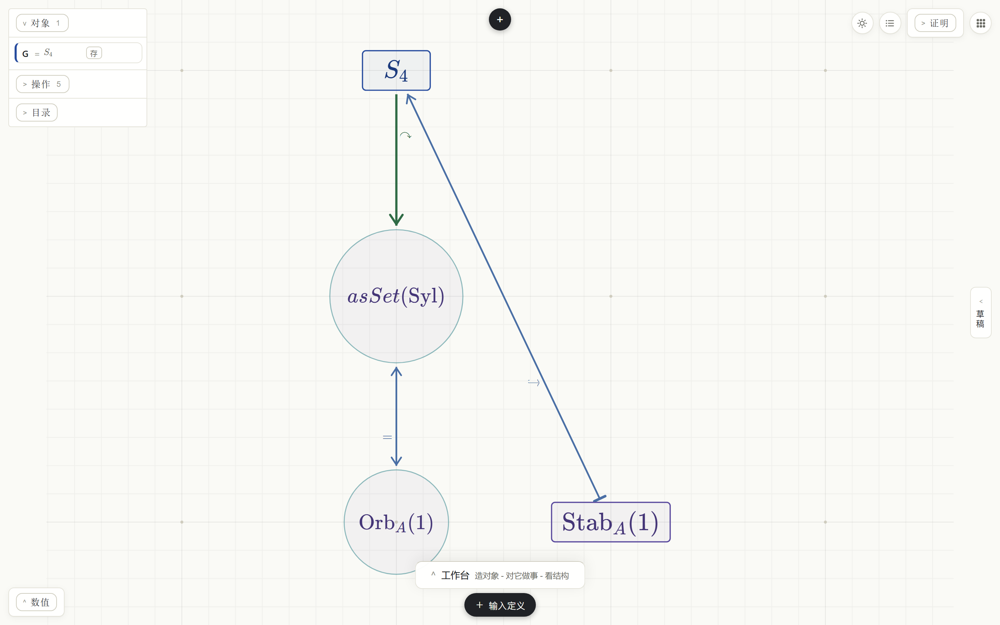
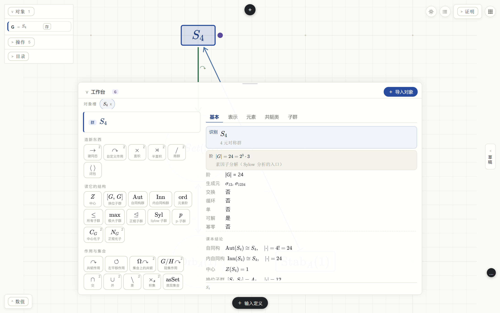

# Galculator · 群论计算器

> *在浏览器里算有限群的结构：子群、商群、同态、群作用。*

[**在线使用**](https://rrCathy.github.io/Galculator/) · [文档](docs/README.md) · [问题反馈](https://github.com/rrCathy/Galculator/issues)



---

## 功能

- **建群**：`S_4` / `D_4` / `A_4` / `Q_8` / `C_12` / `GL(2,3)` 等记号；直积、商群、半直积；内嵌 1–31 阶 93 个小群（编号同 GAP，`smallGroup(16, 3)`）
- **子群**：`Sub` / `Syl` / `pSub` / `maximalSubgroups` / `normalSubgroups` / `Z` / `C_G` / `N_G` / `commutator` / `Aut` / `Inn`，每一项都能取出成独立对象继续算
- **商与同态**：`quotient`、`map`、`ker`、`im`；两个群是否同构由工具判定，判不出来时说「未判定」，不猜
- **群作用**：共轭、左平移、陪集、自定义作用；轨道、稳定子、不动点、Burnside 轨道数
- **集合**：`pointSet(5)` / `labeledSet(a, b, c)` 凭空造，`asSet` 从子群集取，`elementSet` 手挑元素，`{x in S_4 : x^2 = e}` 按条件筛
- **定理模板**：Sylow I / II / III、轨道–稳定子、第一同构定理，逐步执行，每一步写成一行定义
- **三种操作入口**：底部输入框、点画布对象、把一个对象拖到另一个上
- 计算全部在浏览器里完成，没有后端

---

## 快速开始

在线使用：<https://rrCathy.github.io/Galculator/>

本地运行（Node ≥ 20，pnpm 9）：

```bash
git clone https://github.com/rrCathy/Galculator.git
cd Galculator
pnpm install
pnpm dev        # http://127.0.0.1:5273
```

地址后加 `?empty=1` 从空白画布开始。

---

## 用法

输入框在页面底部，格式为 `名字 = 表达式`，名字留空会自动命名。回车后画布上出现对象。

```text
G = S_4
```

点这个节点，底部工作台显示它的信息：阶（24 = 2³·3）、生成元、是否交换 / 循环 / 单 / 可解 / 幂零、同构识别、元素表、共轭类、子群。

**按条件筛选元素**

```text
G = S_4
J = {x in S_4 : x^2 = e}
```

得到一个含 10 个元素的集合。若这批元素对乘法封闭，面板会注明它本身是子群，并给出「升格为群」。

**商群**

```text
G = S_4
N = closure(G, (12)(34), (13)(24))
Q = quotient(G, N)
```

`Q` 阶 6，画布上画出 `G → Q` 的商映射。

完整的 47 条操作在 [`apps/web/src/gal/ops.ts`](apps/web/src/gal/ops.ts)，界面上点右上角「操作表」可以看全量。常用的一批：

| 输入 | 结果 |
|---|---|
| `P = G x H` · `Q = G / N` · `N : H` | 直积 / 商群 / 半直积 |
| `K = closure(G, r2, s)` · `K = <J>` | 由生成元生成子群 |
| `Z = Z(G)` · `C = C_G(G, x)` · `N = N_G(G, H)` · `Inn(G)` | 由作用导出的子群 |
| `S = Sub(G)` · `Syl(G, 2)` · `pSub(G, 3)` · `normalSubgroups(G)` | 子群集 |
| `A = conjAction(G)` · `conjOn(G, Ω)` · `cosetAction(G, H)` · `leftAction(G)` · `customAction(G, 4, a -> (1 2 3 4))` | 群作用 |
| `O = orbits(A, x)` · `stabilizer(A, x)` · `fix(A)` · `burnside(A)` | 轨道 / 稳定子 / 不动点 / 轨道数 |
| `f = map(G, H, r -> e, s -> s)` · `ker(f)` · `im(f)` | 同态 |
| `V = pointSet(5)` · `L = labeledSet(a, b, c)` · `E = elementSet(G, (12), (34))` | 集合 / 元素集 |
| `K = smallGroup(16, 3)` | 从内嵌小群表导入 |
| `ord(G, (123))` · `Aut(G)` · `gcd(12,18)` · `phi(12)` · `factor(24)` · `C(12,4)` | 属性与算术 |

操作名一律 ASCII 英文，与菜单标签一致（`S_4` 而不是 `S₄`）。元素可以写 `id`、标签或循环记号（`(12)`、`(123)`）。

---

## 界面



- **画布**：群画成方框，集合画成圆，映射与作用画成箭头。同一列的对象水平对齐，箭头按映射类型区分（满射、单射、同构）。
- **工作台**：点对象后从底部升起。左边是随当前对象变化的操作键，右边是它的属性分区（基本 / 表示 / 元素 / 共轭类 / 子群）。
- **左上抽屉**：对象、操作、目录（目录里可以造集合、从 93 个小群里挑）。
- **右上**：操作表、证明模板、主题切换。

---

## 开发

```bash
pnpm install
pnpm dev                                  # 开发服务器
pnpm build                                # 生产构建
pnpm --filter @galculator/web typecheck   # 类型检查
pnpm --filter @galculator/web verify      # 语义层断言（纯逻辑，不需要浏览器）
pnpm --filter @galculator/web verify:e2e  # 浏览器走查（需先起 dev server）
```

测试规模：2600 条语义断言 + 1476 条浏览器断言（41 套）。

---

## 技术栈

| 层 | 技术 |
|---|---|
| 前端 | React 19 + TypeScript + Vite |
| 计算内核 | [`@groupviz/core`](https://github.com/rrCathy/GroupViz) v2.3.0（纯算法层，无 DOM 依赖） |
| 排版 | KaTeX |
| 画布 | 自研 SVG |

## 项目结构

```
apps/web/
  src/gal/      计算与派生逻辑（无 React）：值类型、操作注册表、求值、画布派生、证明模板
  src/ui/       画布与面板：SVG 交换图、抽屉、悬浮球、输入卡、工作台
  verify/       测试：suites/（语义断言）· e2e/（浏览器走查）
docs/           架构、交互、图规范、计算清单、开发记录
```

---

## 限制

- 子群枚举与结构分解有阶数上限（约 60 阶），超限时提示「没算」而不是返回结果。
- `image(f, H)` 在 H 有多个嵌入时不自动选择。
- 裸群之间问正规性会得到「未判定」——`H ⊴ G` 需要 G 里那个具体的子群拷贝。

---

## 文档

| 文档 | 内容 |
|---|---|
| [docs/ARCHITECTURE.md](docs/ARCHITECTURE.md) | 内核分层、值类型、操作清单 |
| [docs/INTERACTION.md](docs/INTERACTION.md) | 交互规范：操作入口、输入层、布局 |
| [docs/DIAGRAM_SPEC.md](docs/DIAGRAM_SPEC.md) | 交换图的绘制规则 |
| [docs/TASKS.md](docs/TASKS.md) | 常见群论计算清单：每条给可粘贴的输入与实测结果 |
| [docs/ROADMAP.md](docs/ROADMAP.md) | 方向、里程碑、当前规划 |
| [docs/HISTORY.md](docs/HISTORY.md) | 开发记录 |

## 依赖

计算内核来自 [GroupViz](https://github.com/rrCathy/GroupViz)。本项目只使用它的算法层 `@groupviz/core`，不使用 `@groupviz/react` 的可视化组件。
